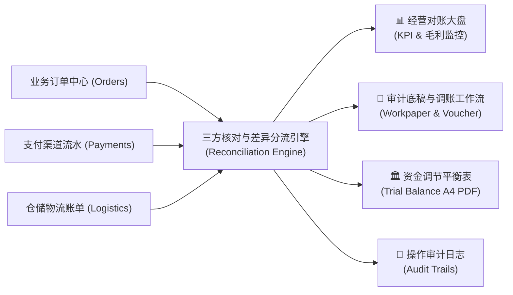
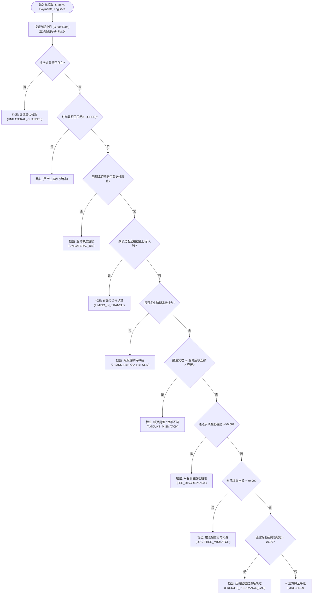
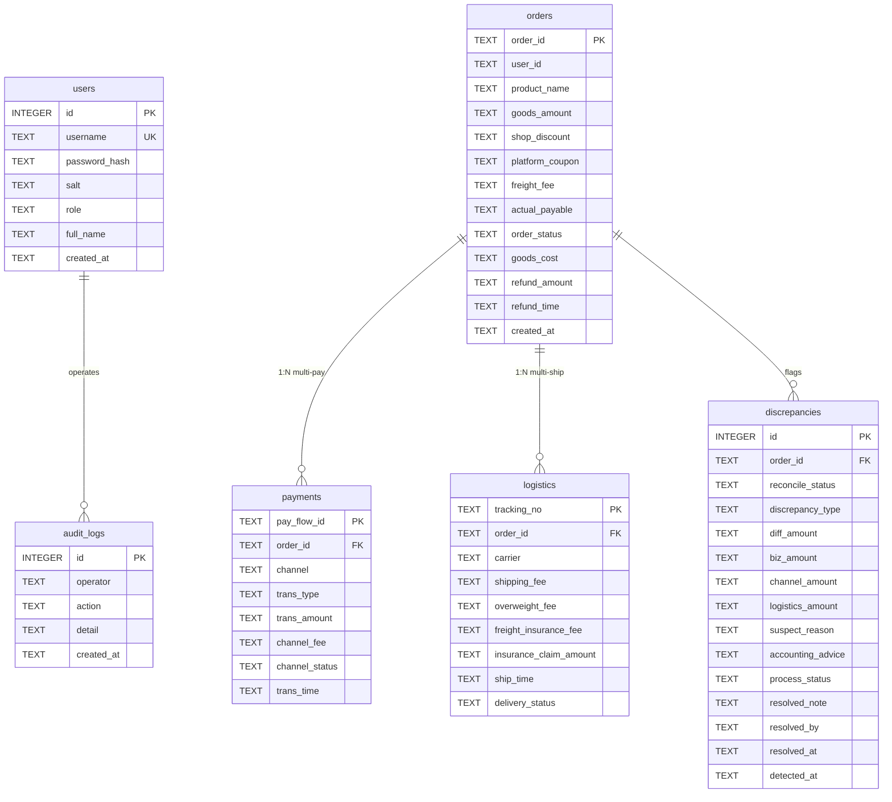

# 小微电商多渠道资金对账与年审异常核算系统 (ecommerce-reconcile v2.1)
## 产品需求文档 (Product Requirements Document - PRD)

---

### 文档控制信息 (Document Control)

| 属性 | 内容 |
| :--- | :--- |
| **产品名称** | 小微电商多渠道资金对账与年审异常核算系统 (E-Commerce Multi-Channel Financial Reconciliation & Audit Workbench) |
| **产品代号** | `ecommerce-reconcile` |
| **当前版本** | v2.1 (Production Ready) |
| **产品负责人 / 架构师** | StarOfCAU |
| **文档状态** | Approved / 生产实施基准 |
| **适用范围** | 电商财务部、门店运营部、会计师事务所审计项目组、系统研发与测试团队 |

---

## 1. 产品背景与商业痛点 (Background & Problems)

### 1.1 业务背景
在中国小微电商（淘系、抖店、拼多多、快手等）经营环境中，商家普遍面临**“高GMV流水、低净利润率（通常在 5%~8% 微利区间）”**的经营现实。日常交易深度依赖第三方平台的营销活动（跨店满减补贴、店铺优惠券）、支付收单渠道（支付宝、微信支付、银联快捷）以及社会化第三方物流（顺丰速运、中通快递、菜鸟裹裹及配套退货运费险）。

### 1.2 核心痛点与行业断层
传统小微电商依靠人工在 Excel 中通过 `VLOOKUP` 或简单的透视表进行月末对账，存在以下致命硬伤：
1. **三方单据断层与信息孤岛**：
   - 业务订单系统（订单中心）、支付网关（收单明细）和物流履约（快递运单）三边数据格式互异、结算时差交织。
   - 经常发生“业务标记已支付但收单掉单”、“渠道扣款成功但业务漏单”等单边账，导致资金流失。
2. **隐藏损益暗扣侵蚀微薄毛利**：
   - **物流超重后补扣费**：快递网点复称二次扣款（面单 1kg 实称 1.8kg），商家每月损失数千元而浑然不知。
   - **平台类目抽佣跳档暗扣**：平台对特定类目抽成从 2% 阶梯跳涨至 5%，商家在对账单未核对时直接被动扣划。
   - **退货运费险理赔滞后未赔**：买家退货后，商家的运费险代扣保费（¥0.80）已被扣除，但保险公司的理赔赔付（¥8.00）因 T+3 审核滞后或漏单，未能真正回款。
3. **财会跨期与借贷试算失衡**：
   - 月末截止日（Cutoff Date）往往存在大量 T+1/T+2 在途结算款以及跨月退款冲红。传统对账未区分会计期间，导致收入与现金流出现时间性差异错位。
   - 传统系统计算毛利未扣除商品采购成本（COGS），算出 90%+ 的虚假毛利，无法指导企业定价决策。
4. **人工调账无闭环与审计凭证丢失**：
   - 发现差错后，无法直接在系统内记录经办人、调账凭证号或追偿说明，状态容易被新录入单据覆盖重置。
   - 事务所年审时缺乏严谨的《银行与渠道资金调节平衡表》和审计底稿，面临内控合规风险。

---

## 2. 产品愿景与核心目标 (Vision & Objectives)

### 2.1 产品定位
构建一套**“轻量级、零外部服务依赖、定点高精度计算、符合《企业会计准则》复式记账法”**的企业级电商全链路资金对撞与年审核算工作台。

### 2.2 核心衡量指标 (KPIs)

| 目标维度 | 现状 (Excel 人工模式) | 本系统实现目标 (v2.1) |
| :--- | :--- | :--- |
| **对账时效** | 月末耗费 3~5 个工作日手工比对 | **单机 5 秒内** 完成 5,000+ 笔三方对撞与试算平衡 |
| **精度保障** | 存在浮点数截断漂移 (`0.1+0.2 != 0.3`) | **强制定点 `Decimal("0.01")`**，借贷误差恒为 `¥0.00` |
| **隐藏损益识别** | 抽佣跳档、超重扣款漏检率 > 40% | **100% 自动检出** 6 大类、12 种典型电商资金差错 |
| **审计合规** | 调账记录离散，无留痕 | **支持凭证录入、经办人留痕、一键导出 A4 调节表底稿** |
| **部署门槛** | 依赖笨重的云原生微服务与数据库集群 | **零第三方依赖**，Python 标准库 + 原生 SQLite 即开即用 |

---

## 3. 用户角色与 RBAC 权限矩阵 (User Personas & RBAC)

系统采用基于角色的访问控制（RBAC），严格杜绝越权操作：

| 功能权限模块 | 🧑‍💼 年审主审 / 审计员 (`auditor`) | 🏪 电商店长 / 财务专员 (`operator`) | ⚙️ 超级管理员 (`admin`) |
| :--- | :---: | :---: | :---: |
| **查看对账大盘与毛利看板** | ✅ 完全只读 | ✅ 允许访问 | ✅ 允许访问 |
| **单笔交易录入与即时核验** | ❌ 无权录入业务数据 | ✅ 允许录入并触发对账 | ✅ 允许录入并触发对账 |
| **CSV 账单文件批量上传** | ❌ 仅供审计查看 | ✅ 允许批量导入 | ✅ 允许批量导入 |
| **查看差错明细与三方穿透抽屉**| ✅ 完全访问 | ✅ 完全访问 | ✅ 完全访问 |
| **标记已调账 / 录入调账凭证** | ✅ 拥有最终核销审批权 | ✅ 允许录入日常调账说明 | ✅ 允许调账处理 |
| **导出 CSV 审计工作底稿** | ✅ 允许一键导出底稿 | ✅ 允许导出对账单 | ✅ 允许导出 |
| **打印 A4 资金调节平衡表** | ✅ 允许打印/另存为 PDF | ✅ 允许打印 | ✅ 允许打印 |
| **修改对账规则与截止日** | ✅ 允许调整会计参数 | ❌ 无权修改规则 | ✅ 允许修改系统规则 |
| **注入压测数据 / 清空业务数据库**| ⛔ **严格拦截 (403 Forbidden)**| ⛔ **严格拦截清空全库** | ✅ 允许执行高危运维操作 |

---

## 4. 产品功能架构与详细规格说明 (Functional Specifications)

```mermaid
graph TD
    Root["电商资金对账系统 (v2.1)"]
    Root --> M1["1. 经营对账大盘 (Dashboard)"]
    Root --> M2["2. 实时单据录入 (Realtime Ingestion)"]
    Root --> M3["3. 审计差错审核 (Audit Discrepancies)"]
    Root --> M4["4. 交易流水明细 (Transaction Explorer)"]
    Root --> M5["5. 资金调节平衡表 (Trial Balance)"]
    Root --> M6["6. 安全审计日志 (Audit Trails)"]
    Root --> M7["7. 对账规则配置 (Rules Config)"]

    M1 --> M1_1["4项核心 KPI 指标卡 (含 COGS 真实毛利与侵蚀)"]
    M1 --> M1_2["调账前后平账率联动监控"]
    M1 --> M1_3["借贷试算平衡状态实时徽章"]

    M2 --> M2_1["三方表单全字段采集 (订单/支付/物流/成本)"]
    M2 --> M2_2["6 大真实业务异常场景一键预填"]
    M2 --> M2_3["毫秒级判定与会计调账分录即时批注"]

    M3 --> M3_1["多维组合筛选 (处理状态/差错类型/单号搜索)"]
    M3 --> M3_2["智能 UPSERT/MERGE 调账状态持久化"]
    M3 --> M3_3["三方单据穿透对比抽屉 (Drill-Down)"]
    M3 --> M3_4["调账说明、会计凭证号与经办人工作流"]
    M3 --> M3_5["UTF-8 BOM 兼容 Excel 审计底稿导出"]

    M4 --> M4_1["订单 / 支付 / 物流 三子视图切换"]
    M4 --> M4_2["多字段模糊检索与服务端分页"]

    M5 --> M5_1["8 行勾稽闭环复式调节推导"]
    M5 --> M5_2["@media print A4 纯净 PDF 排版输出"]

    M6 --> M6_1["用户登录、单据录入、调账操作全轨迹留痕"]

    M7 --> M7_1["截止日、通道费率、跳档容差、保额动态维护"]
```

---

### 4.1 模块一：经营对账大盘 (Dashboard)
- **4 项核心 KPI 卡片**：
  1. **交易核对总量**：展示三方数据对撞总单数，副标题展示自动平账单量与初始平账率。
  2. **调账后平账率 (Adjusted Match Rate)**：公式为 $\frac{\text{自动平账数} + \text{已调账数}}{\text{总单数}} \times 100\%$，解决人工调账后大盘缺乏正向数据反馈的问题。
  3. **待查审计差错**：展示当前仍处于 `PENDING` 状态的待核销差错总数。
  4. **真实经营毛利 (扣成本)**：展示基于采购成本扣减后的真实毛利额、真实毛利率（5%~15%）及隐藏损益总侵蚀额。
- **全链路损益汇总表**：并排呈现业务应收净额、渠道实际入账、商品采购成本（COGS）、支付手续费扣除、物流履约支出、净毛利额与毛利率。
- **试算平衡状态徽章**：若未解释差异为 `¥0.00`，展示绿色“✓ 借贷试算平衡已闭合”徽章；若存在差额，展示红色告警并高亮未解释差额。

---

### 4.2 模块二：核心三方对账状态机引擎 (Reconciliation Engine)
引擎基于订单主键（`order_id`）聚合关联流水，通过多阶段状态机实施漏斗式差错分流：

#### 12 种真实业务异常检测标准
1. **渠道单边挂账 (掉单长款)**：外部渠道有付款记录，电商平台无对应单据。
2. **业务单边挂账 (漏单短款)**：电商平台标记已付款发货，但资金流水从未到账。
3. **T+1 跨期在途结算**：月末最后一晚成交，收单行跨月后（次月1日）清算入账。
4. **跨期退款冲销**：上月确认销售收入并收款，本月买家发生售后退货退款。
5. **优惠券分摊舍入误差**：平台跨店满减补贴在各商品间分摊计算产生的数分钱尾差。
6. **平台佣金跳档暗扣**：平台运营抽佣从协议基准千六（0.6%）私自阶梯跳档至 5%。
7. **物流复称超重扣费**：承运商实测重量超标，二次补扣额外运费（如顺丰 ¥6.00）。
8. **运费险理赔滞后未赔**：买家退货验收入库，但承保保险公司 T+3 赔付金未按期打入账户。
9. **运输破损补发运费分裂**：一件订单多次发货产生多笔快递单号与二次运费。
10. **恶意少付扣款不全**：渠道端实扣金额少于订单实付应收金额。
11. **单边退款掉单**：买家已取消退款，但支付网关依然发起退划。
12. **抹零分钱容差**：系统允许配置在容差范围内的微小差异自动计入财务费用。

---

### 4.3 模块三：实时单据录入与即时判定 (Realtime Ingestion & Data Safety)
- **多维度录入表单**：
  - **订单域**：订单号、商品名称、标价、店铺优惠、平台券补贴、**采购成本 (COGS)**、**订单状态 (PAID/SHIPPED/REFUNDED/CLOSED)**、**退款金额**、**退款时间**。
  - **支付域**：收单渠道（支付宝/微信/银联）、实际入账扣款金额、渠道手续费、**入账时间戳**。
  - **物流域**：快递商（顺丰/中通/菜鸟）、基础运费、超重费、运费险保费代扣、理赔到账金额、**履约状态 (DELIVERED/RETURNING/RETURNED)**。
- **P0 单号冲突防静默覆盖机制**：
  - 严禁后台无提示覆盖。若录入的订单号在库中已存在，后端接口返回 HTTP 409 Conflict 并携带已有记录快照。
  - 前端弹出核对弹窗，展示已存单据与本次录入的差异，需财务确认后方可覆盖，并在审计日志中记录 `OVERWRITE_ORDER` 与金额变化轨迹（原金额 ➔ 新金额）。
- **P1 金额严格边界校验与千分位清洗**：
  - 支持财务标准千分位逗号（如 `1,000.00`）及货币符号（`¥`, `$`, `￥`）自动解析剥离。
  - 严格拦截非数字字符与负数输入（防止异常单据破坏借贷平衡），退款金额设上限校验（不得大于实付应收）。
- **6 大典型业务场景一键预填**：
  - `正常平账单`、`超重扣费单`、`佣金跳档暗扣`、`运费险滞后未赔`、`T+1跨期在途结算`、`跨期退款冲销`。
- **即时对账卡片反馈**：录入后 50ms 内给出匹配结论、差异金额、排查依据与**标准财会分录建议**（如：`借：主营业务收入（红字） 应交税费-应交增值税(销项红字) | 贷：银行存款`）。

---

### 4.4 模块四：审计差错审核与调账工作流 (Audit Discrepancies)
- **状态持久化合并 (State-Preserving UPSERT)**：
  - 差错明细表不再全量删除清空。系统比对现有库中记录，对已人工标记为 `RESOLVED` 的记录**完整保留调账状态、凭证说明、经办人和调账时间**。
- **三方单据穿透对比抽屉 (Drill-Down)**：
  - 点击任何差错单号，弹出抽屉式大窗，三列平铺展示该单在 **订单中心**、**支付网关**、**物流系统** 发生的所有原始字段明细与多笔关联流水。
- **人工调账与凭证录入**：
  - 审核员点击“调账”输入处理凭证号（例如：`已找顺丰退回超重费 ¥6.00，凭证 SF-REV-9871`），确认后流转为“✓ 已调账”。
  - 误操作时支持一键“撤销调账”。
- **底稿导出**：
  - 一键导出包含 15 个核算字段的 UTF-8 BOM CSV 底稿，直接双击在 Excel 中无乱码打开。

---

### 4.5 模块五：CSV 账单批量智能导入 (CSV Batch Ingestion)
- **主流电商平台列名自适应映射 (P1)**：
  - **订单导出**：自动识别 `订单编号`、`主订单编号`、`业务单号`、`买家实付金额`、`店铺自主优惠`、`跨店满减` 等千牛/抖店常用列。
  - **收单流水**：自动映射 `商户订单号`、`平台流水号`、`支付宝交易号`、`微信支付单号`、`结算金额`、`渠道手续费`。
  - **物流运单**：自动匹配 `运单号`、`快递单号`、`承运商`、`超重补扣费`、`运费险保费代扣`。
- **拖拽上传与模板下载**：
  - 支持直接将 `.csv` 文件拖拽至上传区域，自动去除 UTF-8 BOM 头与逗号千分位。
  - 提供三类标准 CSV 模版的一键下载（带示例数据与规范表头）。
- **合法类型严格校验**：
  - 仅允许 `orders`, `payments`, `logistics` 三类标准文件上传，非法类型立即返回 HTTP 400 并清晰报错，杜绝假成功。

---

### 4.6 模块六：交易流水明细 (Transaction Explorer)
- **三方账单子视图**：
  - `📦 业务订单 (Orders)`：展示订单号、商品、应收金额、采购成本、订单状态、下单时间。
  - `💳 支付流水 (Payments)`：展示流水号、关联订单、支付渠道、交易类型 (PAY/REFUND)、结算金额、通道手续费、入账时间。
  - `🚚 物流履约 (Logistics)`：展示快递运单号、关联订单、承运商、运费、超重费、运费险保费、理赔金额、履约状态、发货时间。
- **功能特性**：支持跨字段单号/商品名模糊搜索，提供服务端分页控制（每页 20/50 条）。

---

### 4.6 模块六：资金调节平衡表与 A4 打印 (Trial Balance)
严格遵循借贷复式记账法勾稽闭环，展示 8 行标准资金调节平衡推导：

$$\begin{aligned}
\text{调节后渠道与银行应到金额} = & \; \text{业务系统账面应收净额} \\
& + \text{渠道单边已入账 (待查长款)} \\
& - \text{业务单边未扣款 (待查短款)} \\
& + \text{跨期退款冲销调节 (下期退款当期多收)} \\
& - \text{在途资金未结算 (T+1跨期在途结算)} \\
& + \text{优惠券分摊与结算尾差调节}
\end{aligned}$$

- **闭环校验**：计算 `未解释差异 = 渠道实际到账金额 - 调节后渠道与银行应到金额`，强制要求差额为 `¥0.00`。
- **打印适配**：配置 `@media print` 样式，隐藏页面黑底侧栏、顶部操作条与交互按钮，生成适合纸质盖章归档的 A4 打印页面。

---

### 4.7 模块七与模块八：安全审计日志与规则配置
- **操作审计日志 (Audit Trails)**：自动记录全量关键动作（登录、退出、实时录入、批量压测、调账核销、参数配置、CSV导入），包含操作人、动作类型、明细和时间戳。
- **规则配置 (Rules Config)**：支持在网页动态维护：
  - 对账截止日 (`cutoff_date`)
  - 期初资金余额 (`initial_cash_balance`)
  - 基准通道费率 (`fee_baseline_rate`)
  - 佣金跳档暗扣阈值 (`commission_jump_threshold`)
  - 运费险标准保额 (`insurance_claim_standard`)
  - 抹零容差 (`tolerance`)

---

## 5. 数据模型与数据库字典 (Data Dictionary)

系统采用原生 SQLite 数据库持久化（`data/reconcile.db`），所有金额字段强制使用 `TEXT` 定点存储并在内存中转换为 `decimal.Decimal`：

---

## 6. 非功能性需求与工业级质量指标 (Non-Functional Requirements)

### 6.1 高精度与财务严谨性
- **零浮点数使用**：代码中禁止任何用于金额计算的 `float` 类型，所有加减乘除与百分比计算必须经由 `Decimal` 并统一使用 `ROUND_HALF_UP` 保留两位小数。
- **复式记账平衡保证**：试算平衡表在任何压测场景下必须保持 `unexplained_diff == Decimal("0.00")`。

### 6.2 性能与并发指标
- **运算性能**：对 1,000 笔订单及其关联的三方流水执行全量核算、差错分流与试算平衡，耗时不超过 **150ms**。
- **零外部服务依赖**：完全依靠 Python 3.9+ 标准库（`http.server`, `sqlite3`, `decimal`, `csv`, `urllib`），无需配置 Redis、PostgreSQL 或安装 Flask/Django，极简开箱。

### 6.3 研发与合规安全
- **敏感信息零容忍**：源码、文档、测试用例、提交历史中杜绝一切真实姓名、私有企业工商名称及机构邮箱。
- **RBAC 防越权**：所有修改性 API（POST）严格校验 Session Token 与用户角色，只读审计员及店长运营均无法清空或重构全库数据，仅超级管理员具备权限。

### 6.4 移动端与仓储手持设备适配 (P2 工业可用性)
- **多端响应式断点**：支持 `@media (max-width: 960px)` 平板模式与 `@media (max-width: 600px)` 移动手持模式。
- **仓储档口友好**：侧边栏在小屏自动折叠收拢为水平胶囊导航，4 列 KPI 卡片平滑自适应为单列/双列展示，数据表格采用 `-webkit-overflow-scrolling: touch` 横向滚动保护，确保运营人员在仓库移动设备上顺畅查单。

### 6.5 演示模拟环境显性化隔离 (P1 审计真实性)
- **演示数据标识**：系统初次启动若注入模拟流水，Web 界面大盘顶部强制呈现醒目的琥珀色提示横幅，明确标注当前为模拟压测环境（数据前缀 `TB202609`）。
- **一键清库实战**：提供超级管理员一键“清空演示数据，开启真实对账”通道，杜绝仿真流水与正式月末财务账单混淆。

---

## 7. 版本发布与演进路线图 (Roadmap)

| 阶段 | 版本 | 核心里程碑 | 状态 |
| :--- | :--- | :--- | :---: |
| **阶段一** | `v1.0` | CLI 离线核算引擎，零浮点定点计算，12 种异常检测单测全通 | 已完成 |
| **阶段二** | `v2.0` | 引入 SQLite 持久化与 Web 原生看板，三角色登录与实时录入 | 已完成 |
| **阶段三** | `v2.1` | **生产级闭环重构**：COGS 真实毛利、截止日时间性差异检测、调账状态智能保留、CSV 上传导出、穿透对比抽屉、A4 打印优化 | **当前交付** |
| **阶段四** | `v3.0` | 商业化多租户支持、微信/支付宝 Open API 直连自动拉取流水对账、自动生成用友/金蝶财务软件凭证对接接口 | 规划中 |

---
*本文档为电商对账系统开发实施与质量验收的标准依据。*
